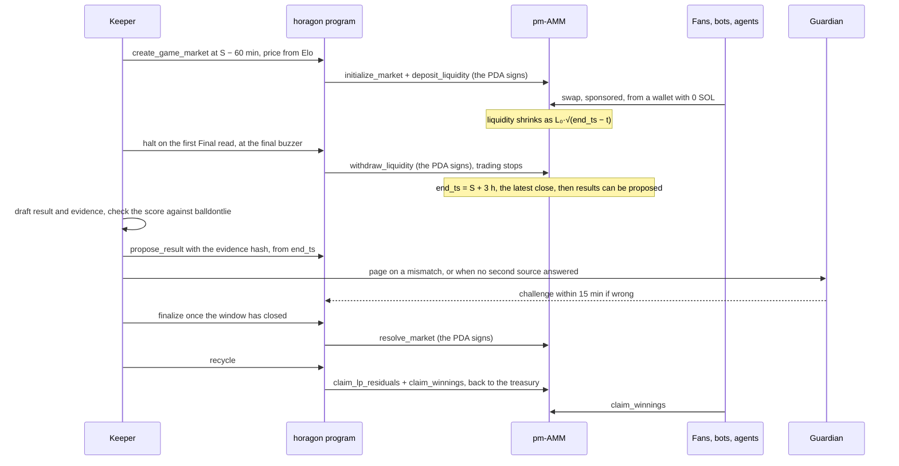

<div align="center">

# Horagon

_Game time, kept._

<sub>The name joins hōra and agōn, Greek for "hour" and "contest": the hour of the contest.</sub>

**Game-day prediction markets for the NBA, built on pm-AMM on Solana. Horagon gives each game one market, "will the home team win?". It opens an hour before tip-off and closes at the final buzzer, when the keeper first reads Final, or at the latest 3 h after the scheduled tip-off, which 263 of 268 games measured ended before. While it is open its liquidity shrinks on pm-AMM's √(time left) schedule. A fan will see every position they hold tonight on one screen, and bots and AI agents will trade the same markets through a typed SDK and API.**

[](https://github.com/horagon-labs/horagon/actions/workflows/ci.yml)
[](#play-money)
[](#status)
[](#why-the-pm-amm)
[](#limits-stated-plainly)
[](LICENSE)

**[Check it yourself](#check-it-yourself)** · **[Why the pm-AMM](#why-the-pm-amm)** · **[The bounty, criterion by criterion](#the-pm-amm-bounty-criterion-by-criterion)** · **[Status](#status)** · **[On-chain proof](#on-chain-proof-devnet-2026-11-18)** · **[Tested, in numbers](#tested-in-numbers)** · **[Limits](#limits-stated-plainly)** · **[Spike report](docs/spikes.md)**

<sub>Built for the Solana Foundation hackathon "Perps and Prediction Markets" (2026) and its bounty "Best use of the pm-AMM by PREDICT" · pm-AMM program <code>GV1FMGHRYBjQLaghE5fnGuYCuCcpdt3GD5xEX3TwN16y</code> on Solana devnet · TypeScript on Node 22, <code>@solana/web3.js</code> 1.98 · Anchor 1.2.2 · Surfpool 1.7.0</sub>

</div>

<a id="play-money"></a>

> [!IMPORTANT]
> **Play-money on devnet. No real value. No prizes.** Every market will trade mUSDC, the pm-AMM
> devnet test token, which anyone can claim from a faucet. There is no mainnet deployment and no
> real-money market. One would come only after legal advice in the builder's jurisdiction.
>
> **This README describes the repository on 2026-11-26, before the first counted night.** The
> `horagon` program is deployed on devnet, the keeper runs on a small Linux server, and the web
> app and API v1 are live at [www.horagon.xyz](https://www.horagon.xyz) (health at
> `/api/v1/health`). The first counted NBA night is ET 2026-11-27. The [Status](#status) table
> separates what runs from what is planned, and a full rewrite of this page is still to come.

## In 30 seconds

Basketball is the case pm-AMM was designed for. The pm-AMM paper (Moallemi and Robinson,
[Paradigm, 2024](https://www.paradigm.xyz/2024/11/pm-amm)) models an outcome as a score that moves
like Brownian motion until a deadline. It names basketball as a better fit than soccer, because
information arrives steadily. Horagon's in-game win probability uses the same model, after
Stern (1994): the normal CDF of the home margin plus a pre-game drift, over σ√(time left), in
[`win-probability.ts`](packages/sdk/src/model/win-probability.ts). The dynamic pm-AMM shrinks
liquidity as L₀·√(T − t). LPs then lose value at an even rate over the game, instead of all at
once in the minutes that decide it.

Horagon builds a game-day product on that model. This is the design (see
[Status](#status) for what runs today):

- **For fans.** A Tonight page lists every NBA game in the next 24 hours, with a market on each.
  A fan buys HOME or AWAY from a burner wallet that holds 0 SOL, because a sponsor pays the
  transaction fee and the token-account rent. A My Game-day screen (planned) is to show the
  night's positions in one place, with the live score, the price and the P&L, and one button to
  claim them all after the final.
- **For builders.** The same markets are reachable through `@horagon/sdk` (used from this
  repository; it is not on npm) and an HTTP API. Bot and agent wallets trade on-chain on pm-AMM
  like anyone else. They are labelled by a memo, and the pre-registered metric counts them
  apart from human wallets.
- **For resolution.** A program-derived address (PDA) of the Horagon program is the authority
  and sole LP of every market. The keeper drafts each result and its evidence JSON, checks the
  score against a second source (balldontlie), and proposes it on-chain with the evidence hash.
  A guardian is paged when the sources disagree or no second source answered, and can challenge
  a proposal for 15 minutes before anyone can finalize it.

It answers the "Game-day mode for prediction markets" entry in Solana's
[Requests for Startups 2026](https://solana.com/request-for-startups): "Build a live game-day
experience around the positions a fan already holds."

**Where it stands on 2026-11-26.** Tier 0 laid the foundation: a TypeScript SDK with a pm-AMM
quote engine and a validator for sponsored transactions, and CI. Tier 1 built the core on it
(below). On 2026-11-26, at commit `2125395`, the repository's test suites passed with db 77 (and 2
skipped), sdk 732, keeper 501, api 180, spikes 41 and web 500 tests, and 14 integration tests
skipped; the count changes with every merge. Five spikes (S1 to S5) answered whether the
plan is feasible, against the real pm-AMM program on devnet or on Surfpool,
a local fork of devnet:

- **S1:** the quote engine matched 6 real devnet swaps, one in each direction. 4 matched to the
  unit, and the worst was off by 0.0011%.
- **S2:** a program PDA acted as the market authority through cross-program invocation (CPI), on
  Surfpool.
- **S3a:** a wallet holding 0 SOL made a sponsored swap on devnet.
- **S3b:** the whole pm-AMM lifecycle ran on Surfpool, whose clock can be moved forward.
- **S4:** the NBA's own data feed refused every server tried, and ESPN's answered. All 12 NBA
  games of 2026-11-18 ET were recorded for replay.
- **S5:** the pm-AMM faucet paid 1,000 mUSDC per wallet to a script, once an hour.

A sixth measurement, end-ts, set the latest close: S + 3 h, from the play-by-play of 268 games.
A market closes at the final buzzer before that.

Tier 1 then built the Horagon program, the keeper, API v1 and the web app, with their tests.
They are now deployed on devnet: the program `HtDJ3vfx9vtFSmskm2Ks39kBMuDmFZH3H2B173BB9qHF`, the
keeper on a small Linux server, and the web app and API at [www.horagon.xyz](https://www.horagon.xyz).
The first live NBA night that counts is ET 2026-11-27.

## Check it yourself

You need no wallet, no key and no account. Each step either reads public Solana devnet data or
runs offline.

**1. Open two devnet transactions in Solana Explorer.**

- [The sponsored swap](https://explorer.solana.com/tx/5Pu68wzGKErA74ggUXS5UwE4Aov73RpSEvrEueBKCtTHZb4x6geA6Y7tZmZ3NvKBkJLKQ8psKK8MJqGa86cY2jBV?cluster=devnet)
  has two signers. The fee payer, the sponsor `32tQ3JDbnnQSqs51BDNzgcy82dW7AKK2EMKDo9ACBnrc`, goes
  from 0.05 to 0.04701312 SOL. The burner, `9qbjWVkoA4Z9SSieAcBnzG8K4zj8F3M955w7spAjK2XW`, has
  0 SOL before and after, and it receives 19.023352 YES for 10 mUSDC.
- [The market create of S1](https://explorer.solana.com/tx/wBKmukjW48o9aZ4LHmqZs8VpBb6zSowvZfsWmFccc2SZQVBvbojco3zA9R4orurYF1nJniKnNGKnhg5Zh1xZfFJ?cluster=devnet)
  calls pm-AMM's `initialize_market` and `deposit_liquidity` in one transaction, at 544,363
  compute units (CU).

**2. Check every devnet claim in this README, with Node 22 and no install** (about 15 s):

```bash
git clone https://github.com/horagon-labs/horagon.git && cd horagon
node scripts/check-claims.mjs
```

[`check-claims.mjs`](scripts/check-claims.mjs) uses only Node's built-in `fetch` and reads devnet
through the public RPC (pass `--rpc <url>` to use your own). It takes every expected value from a
file committed here, the spike results and the swap fixture, and checks it against the chain:

- the 15 cited transactions are finalized without error;
- each of the 6 recorded swaps paid exactly the raw amount that the quote test replays;
- each claim paid 1 mUSDC per winning share;
- the burner held 0 SOL before and after its swap, and the sponsor spent exactly 2,986,880
  lamports;
- the faucet paid exactly 1,000 mUSDC and no SOL (its SOL reserve was empty).

On 2026-11-19 its last line read `14 of 14 claims hold`, and it exited 0.

**3. Replay the six devnet swaps through the quote engine, offline:**

```bash
corepack enable && pnpm install
pnpm --filter @horagon/sdk exec vitest run test/math/quote-s1.test.ts
```

Each swap's market account was recorded just before the swap. The test decodes that account,
quotes the swap with `quoteSwap` and requires it to land within 0.1% of what the chain paid. All
7 tests pass: one per direction, plus a check that the fixture covers all 6 directions. The
engine accrues the reserves to the swap's time, takes the 2% fee on the USDC leg, solves the
curve and floors to raw units, as the program does.

**4. Run the full check:** `pnpm check` runs Biome, the TypeScript type check, the tests with
coverage floors (about 2,000 at 2026-11-26; see the count above), and the build. 14 integration
tests run only against a Surfpool with the program deployed (`HORAGON_IT_RPC`). CI runs the same
steps on Node 22.

## Why the pm-AMM

The bounty asks why pm-AMM works better for this product than the other options. For an in-play
NBA market that a keeper seeds once and leaves running through the game:

| Mechanism                | What happens to an in-play NBA market                                                                                                                                                                                                                                                    |
| ------------------------ | ---------------------------------------------------------------------------------------------------------------------------------------------------------------------------------------------------------------------------------------------------------------------------------------- |
| **Order book**           | Someone must quote both sides all game, and requote every time the score changes. Twelve games a night means twelve markets with no maker on duty and empty books. _(our reasoning)_                                                                                                     |
| **LMSR**                 | A sponsor subsidizes it with a bounded loss, and its loss to arbitrage grows at extreme prices, which every game reaches in the fourth quarter ([Paradigm](https://www.paradigm.xyz/2024/11/pm-amm)).                                                                                    |
| **Constant-product AMM** | Its LP loss is also largest near prices of 0 and 1, and it varies widely over time ([Paradigm](https://www.paradigm.xyz/2024/11/pm-amm)). A game is a market that is certain to end near 0 or 1.                                                                                         |
| **Parimutuel**           | There is no price until the pool closes, and no exit. A fan cannot sell at halftime. _(our reasoning)_                                                                                                                                                                                   |
| **pm-AMM, dynamic**      | It assumes Gaussian score dynamics, which fit basketball. Its loss to arbitrage is the same fraction of pool value at every price. Liquidity shrinks as L₀·√(T − t), so the expected loss rate stays constant until `end_ts`. One deposit at creation is the whole market-making effort. |

**What it makes possible.** Horagon can open a market on every game of the night, a dozen on a
busy night, with a single deposit each. It needs no market maker on duty and no subsidy beyond
that deposit; an optional, disclosed [reference agent](#reference-agent) only nudges a quiet
market toward the model. Prices move continuously, and a fan can sell at any time before the
close.

**Where the fit is imperfect.** pm-AMM has no pause and no early resolution:

- **The close is a halt.** A market still open after the result is known gets sniped, and
  `end_ts` is fixed when the market is created. Horagon sets `end_ts` at S + 3 h (S is the
  scheduled tip-off) and closes each market at the final buzzer by halting it on ESPN's first
  Final. Over 268 games, 263 ended before S + 3 h; the other 5 (4 of them in overtime) would
  have closed early. A result can only be proposed from `end_ts` on, so settlement waits for it
  (see [Limits](#limits-stated-plainly)).
- **The only stop is withdrawing liquidity.** The one emergency stop is for the sole LP to
  withdraw everything, which makes the next swap fail with `InsufficientLiquidity` (6004). S1
  measured exactly that.
- **The model leaves out fees and MEV.** The paper models neither trading fees nor MEV; pm-AMM
  charges 2% on the USDC leg.

## The pm-AMM bounty, criterion by criterion

The bounty's six criteria in its own order, and where Horagon stands on each today:

| Criterion                     | Where Horagon stands on 2026-11-26                                                                                                                                                                                                                                                                                                                                                                                                                                                                                                                                                                                                                                       |
| ----------------------------- | ------------------------------------------------------------------------------------------------------------------------------------------------------------------------------------------------------------------------------------------------------------------------------------------------------------------------------------------------------------------------------------------------------------------------------------------------------------------------------------------------------------------------------------------------------------------------------------------------------------------------------------------------------------------------ |
| **Traction** (biggest weight) | **None yet.** The site, API, keeper and program are live on devnet, but no counted night has run. The first counted NBA night is ET 2026-11-27. Wallets, trades and volume are counted from the chain by the pre-registered metric ([`docs/metrics.md`](docs/metrics.md)); team wallets are listed in [`docs/metrics-wallets.json`](docs/metrics-wallets.json) and excluded, and bot wallets are reported apart from humans. A public `/metrics` page is not built; it is decided on 2026-12-05. This row will carry those numbers.                                                                                                                                      |
| **Why the pm-AMM**            | [The section above](#why-the-pm-amm), with the model in [`win-probability.ts`](packages/sdk/src/model/win-probability.ts) and the time-rescaled quote in [`rescale.ts`](packages/sdk/src/math/rescale.ts) and [`quote.ts`](packages/sdk/src/math/quote.ts).                                                                                                                                                                                                                                                                                                                                                                                                              |
| **Narrative**                 | A fan already holds positions during a game. Horagon gives each game a live market, and a My Game-day screen for a fan's positions (planned, R7) is how it answers the RFS entry. Bots and agents trade the same pm-AMM markets as the fan's counterparties.                                                                                                                                                                                                                                                                                                                                                                                                             |
| **Depth of integration**      | Tier 0: a port of pm-AMM's accrual and curve that matches 6 devnet swaps; a program PDA as market authority through CPI (S2, on Surfpool); a sponsor validator that decodes pm-AMM instructions by their IDL discriminators and only pays for `swap`, `redeem_pair` and `claim_winnings` on Horagon markets; the pm-AMM TypeScript SDK vendored at a pinned commit. Built in Tier 1 and deployed on devnet: the Horagon program uses CPI for `initialize_market`, `deposit_liquidity`, `withdraw_liquidity` (halt), `resolve_market`, `claim_lp_residuals` and `claim_winnings` (recycling the treasury), and the keeper's indexer reads every trade on Horagon markets. |
| **Product today**             | **Live on devnet.** The program, the keeper (on a small Linux server), API v1 and the web app (Tonight and Game pages, burner wallet, trading, claim) run. A reference agent is installed next to the keeper and starts in dry run. The first counted NBA night is ET 2026-11-27.                                                                                                                                                                                                                                                                                                                                                                                        |
| **Standalone potential**      | Sports are where prediction-market volume is: 77 to 81% of Kalshi's volume from May to July 2026 ([Pew Research](https://www.pewresearch.org/short-reads/2026/09/23/prediction-markets-trading-volume-doubled-between-may-and-july-largely-driven-by-sports/)). A game is the moment a fan cares most. The same code would run on any pm-AMM collateral mint. The typed SDK and the HTTP API let outside bots and agents trade as counterparties; a CLI, an MCP server and a replay sandbox are not planned before submission. A real-money version is out of scope until legal advice ([Limits](#limits-stated-plainly)).                                               |

## Status

What exists at this commit, and what does not yet. The plan from here is the R-list of the
rescope plan, up to the submission deadline of 2026-12-08, 21:00 UTC.

| Component                                                                                                                         | Status                                                                                                                                                                                                                                    | Where                                                                  |
| --------------------------------------------------------------------------------------------------------------------------------- | ----------------------------------------------------------------------------------------------------------------------------------------------------------------------------------------------------------------------------------------- | ---------------------------------------------------------------------- |
| pm-AMM quote engine: accrual (time rescale), the dynamic curve and the 2% fee, in all 6 swap directions                           | **Built** (Tier 0). It matches 6 devnet swaps: 4 exactly, worst error 0.0011%. A lagging client clock quotes at the chain's effective time, never before the last accrual                                                                 | [`packages/sdk/src/math`](packages/sdk/src/math)                       |
| pm-AMM bindings: program and mint constants, PDAs, `Market` account decoding, instruction discriminators, error mapping           | **Built** (Tier 0)                                                                                                                                                                                                                        | [`packages/sdk/src/pm-amm`](packages/sdk/src/pm-amm)                   |
| Win-probability model: Elo before the game (K 20, home advantage 100), Brownian in-game model                                     | **Built** (Tier 0). Shown to fans; the reference agent trades toward it                                                                                                                                                                   | [`packages/sdk/src/model`](packages/sdk/src/model)                     |
| Resolution evidence: an RFC 8785 (JCS) canonical JSON and its sha256                                                              | **Built** (Tier 0)                                                                                                                                                                                                                        | [`packages/sdk/src/evidence`](packages/sdk/src/evidence)               |
| Sponsor validator: an allowlist for every instruction of a fee-paid transaction                                                   | **Built** (Tier 0), 40 tests. It ties outcome-token ATA creates to the markets the transaction trades, and reports how many it approved                                                                                                   | [`packages/api/src/sponsor`](packages/api/src/sponsor)                 |
| Spikes S1 to S5                                                                                                                   | **Done.** S1, S2 (Surfpool), S3a, S3b and S5 pass. S4 fails on the NBA CDN, which refused every host, and ESPN replaces it. All 12 games of 2026-11-18 ET are recorded                                                                    | [`docs/spikes.md`](docs/spikes.md), [`spikes/results`](spikes/results) |
| Replay fixtures: 12 recorded NBA games, 233 to 308 frames each                                                                    | **Built** (Tier 0)                                                                                                                                                                                                                        | [`tests/fixtures/replay`](tests/fixtures/replay)                       |
| CI: lint, type check, test, build on Node 22; security scans; program build                                                       | **Built.** The security job runs the gitleaks CLI (pinned by checksum), osv-scanner and `pnpm audit`; `program.yml` runs the program build, IDL check and `cargo audit`. Both also run on pushes to `tier2`                               | [`.github/workflows`](.github/workflows)                               |
| `horagon` program (Anchor): config, game markets, halt, propose, challenge, finalize, recycle                                     | **Built** (Tier 1), live on devnet                                                                                                                                                                                                        | [`programs/horagon`](programs/horagon)                                 |
| Keeper: schedule, ESPN feed, Elo, market creation, halts, evidence, proposals, treasury, indexer, alerts                          | **Built** (Tier 1), live on devnet                                                                                                                                                                                                        | [`apps/keeper`](apps/keeper)                                           |
| Reference agent: one disclosed team wallet that trades toward the model on quiet live markets ([below](#reference-agent))         | **Built**, installed next to the keeper, starting in dry run (it decides and sends nothing); it goes live only after `main` is public. Off unless `AGENT_ENABLED=1`, and it refuses to start unless its wallet is listed as `team-burner` | [`apps/keeper/src/agent`](apps/keeper/src/agent)                       |
| API v1: reads, transaction building, sponsored submit, faucet                                                                     | **Built** (Tier 1), live on devnet                                                                                                                                                                                                        | [`packages/api`](packages/api)                                         |
| Web: Tonight, Game, burner wallet, trading, claim                                                                                 | **Built** (Tier 1), live on devnet                                                                                                                                                                                                        | [`apps/web`](apps/web)                                                 |
| My Game-day, the Verify page, a public Metrics page, share cards                                                                  | **Planned**: My Game-day (R7) and the Verify page (R6); a public Metrics page is decided on 2026-12-05. The per-game share card and the Share button are built (R5)                                                                       | —                                                                      |
| Leaderboards and Night Rank, Season, badges, Crews, the fan-facing Telegram bot, a second guardian (watcher), second-half markets | **Cut** (decision 6, 2026-11-26): not built before submission                                                                                                                                                                             | —                                                                      |
| CLI `horagon`, local sandbox, API keys, OpenAPI, MCP server, Agent Skills, templates, Python SDK                                  | **Not planned** before submission                                                                                                                                                                                                         | —                                                                      |
| Third-party audit                                                                                                                 | **Not planned** for the hackathon                                                                                                                                                                                                         | —                                                                      |

## On-chain proof (devnet, 2026-11-18)

Every transaction below is on Solana devnet and was sent by a spike script in
[`spikes/src`](spikes/src). Its numbers come from the committed result files. `node
scripts/check-claims.mjs` reads each one back from the chain.

**S1: the full pm-AMM lifecycle, 09:13 to 09:23 UTC.** It used market
[`JBEvyrW6…`](https://explorer.solana.com/address/JBEvyrW6w6bbcGFnUuNdN5AdNBayiBRB4ggoFmX5D4tH?cluster=devnet),
which was seeded with 500 mUSDC and given a 10-minute life.

| Step                   | What the chain did                                                                                                                           | CU      | Transaction                                                                                                                                           |
| ---------------------- | -------------------------------------------------------------------------------------------------------------------------------------------- | ------- | ----------------------------------------------------------------------------------------------------------------------------------------------------- |
| Create and seed        | `initialize_market` and `deposit_liquidity`; 0.03538216 SOL spent including rent                                                             | 544,363 | [`wBKmukjW…`](https://explorer.solana.com/tx/wBKmukjW48o9aZ4LHmqZs8VpBb6zSowvZfsWmFccc2SZQVBvbojco3zA9R4orurYF1nJniKnNGKnhg5Zh1xZfFJ?cluster=devnet)  |
| Buy YES                | 20 mUSDC in, 38.721969 YES out; quote exact; price 0.5000 → 0.5123                                                                           | 482,870 | [`dBvPN4uJ…`](https://explorer.solana.com/tx/dBvPN4uJhdZAGeoTWxZJNSkUCgVa5Cd2iuKi2QvYCD8Z6xEqsovLxQNoQN4t8Hn5er3GRbs2Z1APwXTv4y7HgGA?cluster=devnet)  |
| Buy NO                 | 20 mUSDC in, 39.673496 NO out; quote 4 raw units short (0.00001%)                                                                            | 499,776 | [`3H36aPZp…`](https://explorer.solana.com/tx/3H36aPZp9W7Qe1p6XJ6uDQdszLQdd91CvcK8NkkP3no2tPwfV7dYA14C4SuHbcZ7i5r1uMMuNzkgAWN6EJFqnMas?cluster=devnet) |
| Sell YES               | 9.680492 YES in, 4.724744 mUSDC out; quote exact                                                                                             | 391,187 | [`4EKRRWpZ…`](https://explorer.solana.com/tx/4EKRRWpZqscG6Ni7CLgP1XjwMC2CVsi5rrMTwVovRHYCGuKm6Eh4P4NjbL7jHaXd9aqh47QieF5qzX6RUZYzGQgt?cluster=devnet) |
| Sell NO                | 9.918374 NO in, 4.878720 mUSDC out; quote exact                                                                                              | 393,988 | [`2d4qntN3…`](https://explorer.solana.com/tx/2d4qntN3vYXcBzK5cZA7RVzXLxyFvFeTAfCi7LinS6HhnenAB53q7i8vNSJQBHQyjwtHkTmjUebuUxkhk7J4nQqF?cluster=devnet) |
| YES → NO               | 7.260369 YES in, 7.183290 NO out; quote exact                                                                                                | 469,453 | [`3pqn1oaj…`](https://explorer.solana.com/tx/3pqn1oajjkkEAAK2FhNjfQ4GeYde4aStXwRPnqwaiHeuCqYRS47EARHy1n2CPuL43V6CVmZu7RzGVAac8Us78DZg?cluster=devnet) |
| NO → YES               | 9.234603 NO in, 9.308451 YES out; quote 99 raw units short (0.0011%), the worst of the six                                                   | 483,443 | [`28Ug53JV…`](https://explorer.solana.com/tx/28Ug53JVZaPnvtdhzw1duRd9QH71sCjdrHvp4h4ae7RstDT22ESd8hq3rduRkn5g54DibYVR4zj2k6ucCXnAqnaJ?cluster=devnet) |
| LP residuals, mid-life | `claim_lp_residuals`                                                                                                                         | 361,643 | [`3F91XiiB…`](https://explorer.solana.com/tx/3F91XiiBQKAzcM7j3355uXfZK2KvS6bcM1T3Ui3JKorw49rvAs5SztaRWsEvG94y4Zv7v8oFBH1JofyYFzJBUezt?cluster=devnet) |
| Withdraw all liquidity | `withdraw_liquidity` of every share; `l_zero` becomes 0, and the next swap fails with 6004 `InsufficientLiquidity`, the only stop pm-AMM has | 333,942 | [`5prStGuJ…`](https://explorer.solana.com/tx/5prStGuJtQKWescUirJaLGb4vC8nv2Wc1BXsHcGJ7pBoKBaxpw39LPvkdXAD7rLMet2mx8Mhbd31vAbb2KqeFD4p?cluster=devnet) |
| Resolve                | `resolve_market(YES)` after `end_ts`                                                                                                         | 4,545   | [`2abi57Wz…`](https://explorer.solana.com/tx/2abi57WzmirJ1diFTx1Kvhb2c1zkX7Xbifj7PW2hZ1v5auum9UsEr3Accj5EKzWhz8ph6Yum1STUU4oA3XwpzUcz?cluster=devnet) |
| Trader claims          | `claim_winnings`: 31.089559 YES → 31.089559 mUSDC                                                                                            | 21,940  | [`3PEv3CMe…`](https://explorer.solana.com/tx/3PEv3CMecgdbs2yAZMmj1RvBQKUVbccxac3GqNC4vk3SP19rqJdXXrkZSPN4vA3c849vk2NmfyvG7D6DQ2btSWJ6?cluster=devnet) |
| Creator claims         | `claim_winnings`: 498.310985 YES → 498.310985 mUSDC                                                                                          | 21,958  | [`Ubr7KHAH…`](https://explorer.solana.com/tx/Ubr7KHAH6hNYyZAuCrvojhg4PoZjU81mun5VEUYVixjEbbczo6DbQwgmCrZxv5vWF8tchpSMqnmzJBH8sWLCirg?cluster=devnet)  |

The prices and quote errors come from `quoteSwap` on the recorded market accounts, in
[`s1-swaps.json`](packages/sdk/test/fixtures/s1-swaps.json). The 20 mUSDC buy cost 0.5165 mUSDC
per YES on average, including the 0.4 mUSDC fee, on a 500 mUSDC pool with under 10 minutes
left.

**S3a: a sponsored swap from a 0-SOL burner, 09:31 UTC.** It traded on market
[`qpF2PseR…`](https://explorer.solana.com/address/qpF2PseRguMvq4bK1jbWodfCapfCPFmrYcrNjMYj4AK?cluster=devnet),
in transaction
[`5Pu68wzG…`](https://explorer.solana.com/tx/5Pu68wzGKErA74ggUXS5UwE4Aov73RpSEvrEueBKCtTHZb4x6geA6Y7tZmZ3NvKBkJLKQ8psKK8MJqGa86cY2jBV?cluster=devnet).

- **The burner.** It signed a 10 mUSDC buy and received 19.023352 YES. It held 0 SOL before and
  after.
- **The sponsor.** It co-signed as fee payer and spent 2,986,880 lamports: a 10,000-lamport fee
  plus 2 × 1,488,440 lamports of rent for the burner's YES and NO token accounts.
- **The transaction.** 506,088 CU, 864 bytes.
- **The refusals.** The spike ran the validator behind a local HTTP route
  ([`s3a-sponsor.ts`](spikes/src/s3a-sponsor.ts)). The same route refused four disallowed
  transactions, each with HTTP 400, code `SPONSOR_REJECTED` and its own rejection reason:
  - a SOL transfer out of the sponsor (`SPONSOR_MISUSE`);
  - `deposit_liquidity` (`PM_AMM_RULE`);
  - a token account for a stranger (`ATA_RULE`);
  - a compute limit above the cap (`COMPUTE_BUDGET`).

  These four refusals happened off-chain, so they have no transactions.

**S5: the pm-AMM faucet, 06:02 UTC.** Two wallets each received exactly 1,000 mUSDC and no SOL,
because the faucet's SOL reserve was empty:
[`4J2LBewD…`](https://explorer.solana.com/tx/4J2LBewD6hBoiBNejN89ocXR9Zafxn8MjSvx47P7xc7h2d89iVNft7aUETRRAYWePGXzb4kXFjvrLeX2Mz8UFpJQ?cluster=devnet)
and
[`4jfigS2M…`](https://explorer.solana.com/tx/4jfigS2MFBhVnEfz44Yi89uxkStNCnnKeQTs8AVvwxfgXYBTRSkSZdUp7T7rru2dNxUnKweWGxpS8Tzm4KXARSLn?cluster=devnet).
A second claim within the hour was refused with HTTP 429 and `Retry-After: 3596`.

**S2 and S3b ran on Surfpool**, a local fork of devnet, so their transactions are not public.
They are summarized in [`docs/spikes.md`](docs/spikes.md):

- **S2** passed 9 of 9 checks. A program PDA created and seeded a market through CPI at invoke
  depth 4 of 5 (the transaction was 756 of 1,232 bytes and used 577,046 CU), resolved it, and
  received the 1% creator fee.
- **S3b** passed 18 of 18 checks, with Surfpool's time travel.

## Tested, in numbers

Counted on 2026-11-21: the tests and coverage with `pnpm check` on branch `tier1`, at commit
`4b25f36` plus the commit that adds this text (whose only new tests are the 5 of the runbook
check). The devnet figures and the recorded night are from commit `a42801b` on `main`, and the
`end_ts` row from the end-ts measurement.

| What                                       | Figure                                                                                                                                                                                                                                                                                                                                                     | Source                                                                                                                                                                                             |
| ------------------------------------------ | ---------------------------------------------------------------------------------------------------------------------------------------------------------------------------------------------------------------------------------------------------------------------------------------------------------------------------------------------------------- | -------------------------------------------------------------------------------------------------------------------------------------------------------------------------------------------------- |
| Automated tests                            | **1,048 passed, 0 failed**: 410 in `@horagon/sdk`, 323 in `@horagon/keeper`, 141 in `@horagon/api` (40 of them for the sponsor validator), 101 in `@horagon/web`, 37 in `@horagon/db`, 36 in the spike helpers (13 of them for end-ts). The 12 tests of `@horagon/integration` need a Surfpool with the program deployed and are skipped without one       | `pnpm check`; [CI](.github/workflows/ci.yml) runs the same on Node 22                                                                                                                              |
| Line coverage                              | `@horagon/sdk` 97.46% (`math`, `evidence` and `model` 100%), `@horagon/keeper` 98.96%, `@horagon/web` 99.28%, `@horagon/api` 95.48% (the sponsor code 97.33%), `@horagon/db` 86.66%. CI fails below 90% for the SDK's `math`, `evidence` and `model`, the sponsor code and the keeper's feeds, below 95% for the keeper's planner, and below 70% elsewhere | [`packages/sdk/vitest.config.ts`](packages/sdk/vitest.config.ts), [`packages/api/vitest.config.ts`](packages/api/vitest.config.ts), [`apps/keeper/vitest.config.ts`](apps/keeper/vitest.config.ts) |
| Quote against the chain                    | 6 of 6 devnet swaps within 0.1%. 4 match exactly; the worst is off by 0.0011%                                                                                                                                                                                                                                                                              | [`quote-s1.test.ts`](packages/sdk/test/math/quote-s1.test.ts), [`s1-swaps.json`](packages/sdk/test/fixtures/s1-swaps.json)                                                                         |
| Devnet claims                              | 14 of 14 hold, read live from public devnet RPC                                                                                                                                                                                                                                                                                                            | [`scripts/check-claims.mjs`](scripts/check-claims.mjs)                                                                                                                                             |
| Cost of one market                         | 0.03538216 SOL (rent and fee), not recoverable: pm-AMM has no instruction that closes a market                                                                                                                                                                                                                                                             | S1                                                                                                                                                                                                 |
| Cost of a player's first trade on a market | 2,986,880 lamports paid by the sponsor (fee plus two token-account rents), when the player's mUSDC account and the fee accounts already exist; 1,488,440 more if the sponsor also creates the mUSDC account. About 10,000 for later trades                                                                                                                 | S3a                                                                                                                                                                                                |
| Compute                                    | Swaps used 391,187 to 506,088 CU. The sponsored swap set an 800,000 limit (the validator allows at most 1,000,000); S1's swaps set 1,400,000. Market creation through a program PDA used 577,046 CU, against 1,400,000                                                                                                                                     | S1, S3a, S2                                                                                                                                                                                        |
| Faucet                                     | 1,000 mUSDC per wallet per hour; no SOL on 2026-11-18, because its SOL reserve was empty                                                                                                                                                                                                                                                                   | S5                                                                                                                                                                                                 |
| Recorded NBA night                         | 12 games of 2026-11-18 ET, 4,890 raw lines (1.25 GB), from 23:30 UTC to 05:41 UTC, compacted into 12 replay fixtures of 233 to 308 frames                                                                                                                                                                                                                  | S4, [`tests/fixtures/replay`](tests/fixtures/replay)                                                                                                                                               |
| Market close (`end_ts`)                    | The final buzzer, by a halt on ESPN's first Final; `end_ts` = S + 3 h 00 min is the latest close. Of 268 regular-season games of 2026-10-20 to 2026-11-25, 5 (1.9%) were still being played at S + 3 h; at S + 2 h 55 min it would have been 16. Measured on 2026-11-26                                                                                    | [`spikes/src/end-ts.ts`](spikes/src/end-ts.ts), [`spikes/data`](spikes/data)                                                                                                                       |
| Feed reachability                          | The NBA CDN answered 403 from a home connection, GitHub Actions and a rented Linux server. ESPN answered 200 from all three                                                                                                                                                                                                                                | [`spikes/results`](spikes/results)                                                                                                                                                                 |

## How a game night works

How a market runs, as built. "S" is the scheduled tip-off time.



1. **Every hour.** The keeper reads the next 36 hours of games and computes each pre-game
   probability p0 from Elo, clamped to [0.05, 0.95]. It picks up to 4 featured games a night.
2. **S − 60 minutes.** The program creates the market at price p0 and seeds it from its treasury:
   1,000 mUSDC for every game (the deployed `SEED_REGULAR_USDC`; the code default for a
   non-featured game is 300).
3. **During the game.** The keeper reads ESPN every 15 seconds and stores score, clock and model
   probability. It halts a market by withdrawing all liquidity in four cases:
   - the game is final while the market is still open: this is how a market closes at the
     final buzzer;
   - the game is postponed or canceled;
   - the game has not started 24 hours after S;
   - the feed goes silent for over 10 minutes in the fourth quarter or overtime. After 2 minutes
     it only alerts the guardian, who can halt by hand, because a halt cannot be undone. From
     S + 1 h 40 min, before any measured game reached the fourth quarter, it alerts on 2 silent
     minutes whatever quarter the feed last showed, so an outage that starts in the third
     quarter cannot hide the fourth.
4. **After the final.** ESPN must report Final with the same score for at least 60 seconds.
   The keeper then drafts the result and its evidence JSON:
   - the score and the score of each period;
   - the rule and the outcome;
   - the sources, each with a fetch time.

   Proposing opens at `end_ts`, S + 3 h. The keeper asks balldontlie, a second score source, for
   the same game. From the later of Final held 60 seconds and `end_ts`, the attestor proposes the
   draft: it publishes the JSON and calls `propose_result` with its sha256, citing balldontlie
   when its final matches. When balldontlie disagrees, nothing is proposed and a guardian is
   paged to check the box score and run
   `horagon-ops propose <gameId> --box-score <url> --score <home>-<away>`. When balldontlie has
   no final 10 minutes after proposing opened, or no key is set, the keeper proposes on ESPN alone
   and pages a guardian to check the box score inside the window. `KEEPER_AUTO_PROPOSE` turns this
   to a dry run (it pages what it would propose and sends nothing) or off, and then a guardian
   proposes every result by hand. Anyone can recompute the hash.
5. **15 minutes later.** If no guardian has challenged, `finalize` resolves the pm-AMM market
   through the PDA. `recycle` then claims the LP residuals and the PDA's winning shares back into
   the treasury. The 1% creator fee needs no step of its own: pm-AMM pays it into the treasury on
   every swap. Players claim.

**Market rules.** YES if the home team wins, overtime included. If a game is postponed and played
within 7 days of its scheduled tip-off, the market resolves on that game; otherwise it resolves
NO. `redeem_pair` (1 YES + 1 NO →
1 mUSDC) works at any time.

<a id="reference-agent"></a>

**Reference agent.** One disclosed team wallet trades toward the win-probability model, so a
market that fans leave quiet still follows the game. It starts in dry run (it decides and sends nothing) and goes live only after `main` is public. It is off unless enabled, and runs as its own process beside the keeper (a separate systemd unit, started by hand) ([`apps/keeper/src/agent`](apps/keeper/src/agent)) and pays its own
fees, never through the sponsor. Every 20 seconds it looks at each live NBA winner market. It
trades one only when the game has tipped off, more than 2 minutes remain before its `end_ts`,
the clock does not read 0:00 in the 4th quarter or overtime (the horn), the model was updated
in the last 60 seconds and no other wallet has traded that market for 90 seconds. If the pool
price is more than 0.04 from the model, it buys YES or NO (it never sells) to bring the price to
0.02 short of the model. It caps a swap at 100 mUSDC, and a market at 2,000 mUSDC and 40 swaps;
a gap one capped swap cannot close takes several rounds. If the gap grows on the same side after
one of its swaps and no trade by another wallet is stored since, it holds that market for 2
minutes; if the gap is still wider then, it stops trading that market and pages.

Its wallet, `7Da24CpktL9Cp4st1iQ3U4ZKHgsRYXXEJx5oGbgFWP1Z`, is listed in
[`docs/metrics-wallets.json`](docs/metrics-wallets.json) as `team-burner`, in a public commit
made before its first swap, and the agent refuses to start unless the copy it ships with lists
it so. Every swap it sends carries the `horagon:bot` memo, so it never counts as a fan, and its swaps are counted as team, not as fans. The game page shows the agent's swaps and volume
apart from the fans' (and from other team or bot wallets), right under the dial, and the site's
`/agent` page ([`apps/web/app/agent/page.tsx`](apps/web/app/agent/page.tsx)) explains how it
trades and how that count is made. `scripts/count-fans.mjs` stays the official count of wallets
and swaps per class. Apart from it, no team wallet swaps on a live
market except in smoke tests and rehearsals, and every team wallet is listed and left out of the
metrics.

## Who can do what

The keys, as deployed. None of these keys holds anything of real value: this is
devnet.

| Key             | Held by                                                                                               | Can                                                                                                             | Cannot                                                |
| --------------- | ----------------------------------------------------------------------------------------------------- | --------------------------------------------------------------------------------------------------------------- | ----------------------------------------------------- |
| Admin           | The builder's wallet                                                                                  | Change the config, withdraw the treasury, upgrade the program                                                   | —                                                     |
| Attestor        | The keeper                                                                                            | Create markets, halt, propose each result automatically once ESPN's Final has held 60 s and `end_ts` has passed | Finalize early, withdraw the treasury                 |
| Guardian 1      | The builder's wallet                                                                                  | Challenge within 15 min when paged, propose by hand after a challenge or a held result, halt                    | Withdraw the treasury                                 |
| Guardian 2      | Not set: the config's second guardian slot is empty                                                   | Nothing                                                                                                         | —                                                     |
| Sponsor         | The API server                                                                                        | Pay fees and rent for allowlisted transactions only                                                             | Sign anything else; it holds only a small SOL balance |
| Reference agent | The agent process on the VPS (`~/horagon/.keys/agent.json`), its only signer; listed as `team-burner` | Sign and pay for its own swaps (each with the `horagon:bot` memo) and claims                                    | Use the sponsor; do anything a player's wallet cannot |
| Authority PDA   | The `horagon` program                                                                                 | Act as each market's authority and sole LP, and own the treasury                                                | Sign outside the program's instructions               |

Proposer: the automated attestor. Challenger: a human guardian, paged on any second-source
mismatch, or when no second source answered. One admin key holds config, treasury and upgrades.

If the attestor key leaks, the attacker can propose a wrong result, halt open markets and create
markets. A guardian challenges a wrong result within the 15-minute window, and the admin pauses
market creation and replaces the attestor ([`docs/security.md`](docs/security.md)).

## Sponsored transactions

A player's wallet never needs SOL. The client builds a transaction with the sponsor as fee payer,
and the player signs it. `POST /api/v1/tx/submit`
([`submit.ts`](packages/api/src/sponsor/submit.ts)) checks the player's signatures and the rate
limits, validates the transaction, co-signs it and sends it; S3a ran the same validator behind a
local spike route. The validator
([`validate.ts`](packages/api/src/sponsor/validate.ts)) is built and reads every instruction. It
refuses a transaction that differs from the allowlist in any point:

- **Compute Budget.** Only a CU limit of at most 1,000,000 and a capped priority fee.
- **Associated Token.** Only `CreateIdempotent` with the sponsor as payer, and at most 5 per
  transaction. The account is either the signer's mUSDC or outcome-token account, or one of the
  two fee accounts a swap needs. An outcome-token account is allowed only for a market that the
  same transaction trades.
- **pm-AMM.** Only `swap`, `redeem_pair` and `claim_winnings`, signed by the player, on a market
  listed as Horagon's.
- **SPL Memo.** At most one instruction, with no accounts and the data `horagon:bot` exactly. A
  client adds it to declare itself a bot, and `POST /api/v1/tx/trade` with `client: "bot"`
  builds it. Any other Memo instruction is refused, as is any program not listed here.
- **The sponsor's role.** It appears only as fee payer and rent payer. No instruction closes
  an account back to it: `claim_winnings` closes the player's YES and NO accounts itself and
  pays their rent to the player.

The verdict reports how many token accounts the sponsor pays for, so the daily SOL cap can count
rent when it is spent.

## Solana and pm-AMM technology used, and how

| Technology                                                          | How Horagon uses it                                                                                                                                                                                                                                    | Where                                                            |
| ------------------------------------------------------------------- | ------------------------------------------------------------------------------------------------------------------------------------------------------------------------------------------------------------------------------------------------------ | ---------------------------------------------------------------- |
| **pm-AMM program** (`GV1F…N16y`, the same id on devnet and mainnet) | Every market is a pm-AMM market. S1 called 7 of its instructions on devnet: `initialize_market`, `deposit_liquidity`, `swap`, `claim_lp_residuals`, `withdraw_liquidity`, `resolve_market` and `claim_winnings`. The sponsor also allows `redeem_pair` | [`spikes/src/lifecycle.ts`](spikes/src/lifecycle.ts)             |
| **pm-AMM TypeScript SDK**                                           | Vendored from `sparkfun-labs/pm-amm` at commit `d5b407b`, because the npm release 0.1.0 points at an old protocol DAO address                                                                                                                          | [`packages/sdk/vendor/VENDOR.md`](packages/sdk/vendor/VENDOR.md) |
| **pm-AMM faucet and mUSDC**                                         | S5 claimed from it with a script. The keeper claims 1,000 mUSDC an hour for the treasury, and players claim through the API (`POST /api/v1/faucet`)                                                                                                    | [`spikes/src/s5-faucet.ts`](spikes/src/s5-faucet.ts)             |
| **Anchor CPI with `invoke_signed`**                                 | A data-less PDA, owned by the System Program, is the market authority. The program signs `initialize_market` and `resolve_market` for it                                                                                                               | [`spikes/s2-cpi`](spikes/s2-cpi)                                 |
| **Fee payer sponsorship**                                           | The sponsor pays fees and rent as fee payer and co-signer, with no relayer service. Kora was not used: it filters by program, not by instruction                                                                                                       | [`packages/api/src/sponsor`](packages/api/src/sponsor)           |
| **Associated Token `CreateIdempotent`**                             | The token accounts of a trade are created in the same transaction, so a first trade does not fail for a missing token account (Anchor error 3012, `AccountNotInitialized`)                                                                             | [`validate.ts`](packages/api/src/sponsor/validate.ts)            |
| **Surfpool**                                                        | A local fork of devnet with time travel, for full-lifecycle tests without waiting for `end_ts`                                                                                                                                                         | [`spikes/src/s3b-surfpool.ts`](spikes/src/s3b-surfpool.ts)       |
| **`@solana/web3.js` 1.98**                                          | Pinned to the 1.x line that the pm-AMM SDK and Anchor use                                                                                                                                                                                              | [`packages/sdk/package.json`](packages/sdk/package.json)         |

## Roadmap

Tiers 0 and 1 are built and deployed. From here the plan is the R-list of the rescope plan (R0 to
R12), which ends at the submission deadline of 2026-12-08, 21:00 UTC; the team submits by
15:00 UTC the same day, and the last feature day is 2026-12-06.

| Step                            | Target     | Scope                                                                                                               | Done when                                                                |
| ------------------------------- | ---------- | ------------------------------------------------------------------------------------------------------------------- | ------------------------------------------------------------------------ |
| Tiers 0 and 1: foundation, core | Done       | The SDK's math and quote engine, the sponsor validator, the `horagon` program, keeper, indexer, API v1, web app     | Deployed on devnet; the first counted NBA night is ET 2026-11-27         |
| Settlement and disclosure       | 2026-11-30 | Auto-propose with a second-source check (R6), fan versus agent volume (R2b), My Game-day (R7)                       | A live night resolves through the dispute window                         |
| Practice, ops and security      | 2026-12-02 | Practice replay loop (R8), salted market ids, sponsor reserve and alerts, CSP, upgrade authority to a cold key (R9) | Each item shipped or cut by 2026-12-02                                   |
| Study, submission               | 2026-12-08 | Mechanism study and calibration from chain (R10), the submission package and a README rewrite (R11)                 | Submitted by 2026-12-08, 15:00 UTC; markets keep running through judging |

Cut on 2026-11-26 (decision 6): Night Rank, Season, badges, Crews, the fan-facing Telegram bot,
leaderboards, the independent watcher, a verifiable build and the public Metrics page decided on
2026-12-05. A CLI, an MCP server, a Python SDK and a replay sandbox for outside builders are not
planned before submission.

## Limits, stated plainly

- **Deployed, but no counted night yet.** The program, keeper, API and web app run on devnet.
  The first counted NBA night is ET 2026-11-27, so there is no traction to report yet.
- **Devnet and play money only.** mUSDC is free from a faucet, so devnet activity costs little
  to fake. The design answers with engaged-wallet counts and separate reporting for bots, but a
  judge may still weigh devnet numbers below mainnet ones.
- **The close at the buzzer is a halt, and results wait for `end_ts`.** pm-AMM cannot pause or
  resolve early, so `end_ts` is fixed at creation, at S + 3 h, and the keeper closes a market at
  the final buzzer by halting it on ESPN's first Final. `end_ts` was set from ESPN's
  play-by-play wallclock for the 268 regular-season games of 2026-10-20 to 2026-11-25
  ([`spikes/src/end-ts.ts`](spikes/src/end-ts.ts), data in [`spikes/data`](spikes/data)):
  - 5 games (1.9%), 4 of them in overtime, were still being played at S + 3 h: their markets
    close before the buzzer. At S + 2 h 45 min it would have been 36, and at S + 2 h 10 min, the
    close until 2026-11-26, all but 1.
  - A result can be proposed only from `end_ts` on. A game of median length ends at
    S + 2 h 32 min, 28 minutes before `end_ts`, and a result becomes final 15 minutes after it
    is proposed. The attestor proposes it once ESPN's Final has held 60 seconds and `end_ts`
    has come; a guardian proposes by hand only a held result, a postponed game, or a game after
    a challenge.
  - The halt waits for the feed. ESPN showed Final 25 to 148 seconds after the buzzer on
    2026-11-18, and the keeper reads it every 15 seconds; until the halt lands the market can
    be sniped. Depth follows √(time left), so at a median buzzer, 28 of the market's 240
    minutes before `end_ts`, it is about a third of the opening depth.
  - A feed silent for 10 minutes in the fourth quarter or overtime halts the market before the
    buzzer.
- **Sniping between the score and the halt.** A trader who sees the score before the feed does,
  for example at the arena, can trade against the pool until the market closes or is halted.
  The shrinking liquidity limits the loss, and in play money Horagon accepts it.
- **No official score feed.** The NBA CDN refused every host tried with 403. Horagon does not
  spoof browser headers to get past it. ESPN's JSON API is undocumented, with no published API
  terms and no SLA. The second source is balldontlie's free API: the keeper proposes when its
  final matches ESPN's, holds the result and pages a guardian when it differs, and asks a
  guardian to check a public box score when it has not answered. ESPN scores can also go down
  within a game (stat corrections): three of the 12 recorded games have such a frame.
- **Sponsor rent can be farmed.** A user owns the token accounts the sponsor paid for, and can
  close them to their own wallet. A claim always does: pm-AMM's `claim_winnings` closes the YES
  and NO accounts and pays their rent to the player. The validator ties outcome-token accounts
  to the traded market and caps them at 5 per transaction. The API opens at most 26 new token
  accounts a day per wallet and 78 per IP hash, and counts their rent as spent when it opens
  them. The keeper watches every account the sponsor paid for, and once a wallet closes one to
  another address outside a claim, the sponsor opens no more for that wallet
  ([`docs/security.md`](docs/security.md#sponsor-rent-is-spend)).
- **S2 is proven on Surfpool; devnet comes with the first markets.** The PDA authority passed on
  Surfpool. The devnet check is the keeper creating markets through the program, which starts
  an hour before the first tip-off of ET 2026-11-27. If it fails, the attestor key becomes the
  market authority, and the dispute window stays on-chain.
- **Surfpool needs Linux.** The local sandbox ran on a remote Ubuntu host; the dev box has no WSL.
- **The pm-AMM program is not Horagon's.** Its own docs call the mainnet deployment a
  "trust-based POC going live with real money"
  ([MAINNET.md](https://github.com/sparkfun-labs/pm-amm/blob/main/MAINNET.md)). Horagon depends
  on its devnet program and faucet staying up.
- **Not audited.** No third party has reviewed this code. The reviews so far were done by AI
  agents (see [AI-assisted code](#libraries-templates-and-ai-assisted-code)).

## Legal perimeter

Horagon is play money on Solana devnet. Horagon never does any of the following:

- **No real-money markets.** Horagon does not create, seed, resolve or take fees on any market
  that trades real money.
- **No custody.** Horagon never holds a user's funds. Players sign with their own wallets; the
  sponsor pays only devnet transaction fees and token-account rent.
- **No prizes.** Nothing on Horagon can be exchanged for money or anything of value.
- **No project token.** Horagon issues no token of its own without a lawyer's opinion first. The
  YES and NO outcome tokens that pm-AMM mints for each market are devnet play money.

## The case against Horagon

Here is the argument against building it:

- **Devnet traction is easy to discount.** Play-money markets on devnet prove less than real
  money would, and a real-money sports market run by a small team is legally hard almost
  everywhere. So the product may never leave devnet.
- **Results come slowly.** Markets trade to the final buzzer, but a result can be proposed only
  from `end_ts` = S + 3 h, so a result waits for `end_ts` and then for the 15-minute dispute
  window, and a game still being played at S + 3 h closes early.
- **The integrity of the result rests on two free feeds and one person.** It depends on an
  unofficial ESPN feed, checked against balldontlie's free tier, and on one guardian to challenge
  a wrong proposal; the second guardian slot is not set.
- **There is no proof yet that anyone wants it.** The core loop has not run in front of a user.

Of these, the design answers some in part:

- the dispute window and the published evidence hash;
- engaged-wallet metrics, with bot wallets reported apart;
- a close at the final buzzer, with an `end_ts` set from 268 games of play-by-play that the
  keeper can move by config as more games come in.

Legal status and demand are not answered by code.

## Where things are in this repository

| Path                                                   | What it is                                                                                                                                                                                                                                                                                                                      |
| ------------------------------------------------------ | ------------------------------------------------------------------------------------------------------------------------------------------------------------------------------------------------------------------------------------------------------------------------------------------------------------------------------- |
| [`programs/horagon`](programs/horagon)                 | The `horagon` Anchor program: config, game markets, halt, propose, challenge, finalize, recycle. Its IDL is committed in [`packages/sdk/idl`](packages/sdk/idl)                                                                                                                                                                 |
| [`idls`](idls)                                         | The pm-AMM IDL that the program's `declare_program!` reads for its CPI                                                                                                                                                                                                                                                          |
| [`packages/sdk`](packages/sdk)                         | `@horagon/sdk`: pm-AMM math and quotes, bindings, errors, model, evidence; trade and claim transaction builders, clients for the `horagon` program and API v1, the recorded-game format. ESM and CJS with types, subpath exports `./math`, `./model`, `./evidence`, `./pm-amm`, `./program`, `./errors`, `./replay`, `./client` |
| [`packages/sdk/vendor/pm-amm`](packages/sdk/vendor)    | The vendored pm-AMM TypeScript SDK, pinned to a commit ([VENDOR.md](packages/sdk/vendor/VENDOR.md))                                                                                                                                                                                                                             |
| [`packages/api`](packages/api)                         | API v1: a Hono app that `apps/web` mounts at `/api/v1`, with reads, transaction building, the sponsor's submit and the faucet                                                                                                                                                                                                   |
| [`packages/db`](packages/db)                           | The Postgres schema (Drizzle), its migrations and the queries the API and the keeper share                                                                                                                                                                                                                                      |
| [`apps/keeper`](apps/keeper)                           | The keeper (schedule, ESPN feed, markets, halts, result drafts, treasury, indexer, alerts), `horagon-ops`, the guardian's command line, and the reference agent                                                                                                                                                                 |
| [`apps/web`](apps/web)                                 | The Next.js web app: the Tonight and Game pages, the burner wallet, trading and claims                                                                                                                                                                                                                                          |
| [`tests`](tests)                                       | `@horagon/integration`, the program against pm-AMM on Surfpool; [`fixtures/replay`](tests/fixtures/replay), 12 recorded NBA games for the keeper's replay mode and one trimmed raw sample                                                                                                                                       |
| [`ops`](ops)                                           | The keeper's deploy script and its systemd units (keeper, watchdog and reference agent)                                                                                                                                                                                                                                         |
| [`spikes`](spikes)                                     | Tier 0 spike scripts and the S2 Anchor program. Throwaway code, kept for the record; results in [`spikes/results`](spikes/results)                                                                                                                                                                                              |
| [`scripts/check-claims.mjs`](scripts/check-claims.mjs) | Re-checks this README's devnet claims against the chain                                                                                                                                                                                                                                                                         |
| [`docs`](docs)                                         | [`dev-setup.md`](docs/dev-setup.md) (developer setup), [`deploy.md`](docs/deploy.md), [`runbook.md`](docs/runbook.md) (game night), [`security.md`](docs/security.md) and [`spikes.md`](docs/spikes.md) (Tier 0 spike report)                                                                                                   |

## Development

Requires Node 22 or later and pnpm 10 (`corepack enable`). The Rust, Solana, Anchor and Surfpool
toolchain is in [`docs/dev-setup.md`](docs/dev-setup.md), including a section on working from a
remote Linux host.

```bash
pnpm install
pnpm check    # Biome lint, type check, tests with coverage, build
pnpm format   # Biome, in place
```

The spikes and their run order are in [`docs/spikes.md`](docs/spikes.md). S1, S3a and S5 send
transactions to devnet and need funded keys in `.keys/`, which git ignores. S2 and S3b run
against a local Surfpool, and S4 sends no transactions. Commits follow Conventional Commits.

## Prior work

Design and code started on 2026-11-18. The first commit is
[`e8ff40d`](https://github.com/horagon-labs/horagon/commit/e8ff40d), at 04:48 UTC. At that time
the hackathon page still listed the event as scheduled, with no launch date or rules published.
Everything since is in the git history. Tier 0 landed as pull request #1, merged in
[`a42801b`](https://github.com/horagon-labs/horagon/commit/a42801b); its 23 commits were reviewed
task by task. The reviewed pull request is in the original repository, which is private.

Before this repository was made public, its history was rewritten: commit identities became the
project identity and references to the original repository now name this one. Commit dates and
times were kept.

## Libraries, templates and AI-assisted code

| Part          | Built with                                                                                                                                                                                                                       |
| ------------- | -------------------------------------------------------------------------------------------------------------------------------------------------------------------------------------------------------------------------------- |
| pm-AMM client | The pm-AMM TypeScript SDK from [`sparkfun-labs/pm-amm`](https://github.com/sparkfun-labs/pm-amm), MIT, vendored unchanged at `d5b407b` except its package manifest and build config ([VENDOR.md](packages/sdk/vendor/VENDOR.md)) |
| Solana        | `@solana/web3.js` 1.98, `@anchor-lang/core` (through the vendored SDK), Anchor 1.2.2 for the `horagon` program and the S2 program                                                                                                |
| API and web   | Hono 4 (API v1), Drizzle ORM 0.45 on Postgres, Next.js 16 with React 19 (web), zod 4 (input checks), pino (logs)                                                                                                                 |
| Tooling       | pnpm 10, Turborepo, TypeScript 5.9, Biome 2, Vitest with V8 coverage, tsup, Changesets, GitHub Actions                                                                                                                           |
| Data          | ESPN's public scoreboard and summary JSON, read for display and replay; balldontlie's free games API, the second score source; evidence cites ESPN and, when it matched, balldontlie, or the box score a guardian checked        |
| Models        | NBA-style Elo (K 20, home advantage 100, 75% carryover toward 1505 between seasons); in-game probability after Stern (1994), "A Brownian motion model for the progress of sports scores"                                         |

**AI-assisted code.** Horagon is built with Claude Code, Anthropic's AI coding agent, which wrote
most of the code, tests and documentation. The builder decided what to build and approved each
merge. Commits written with it carry a `Co-Authored-By: Claude` trailer. Each Tier 0 task was
reviewed by a separate AI agent before the next began. Then the whole branch had a final review
and one round of fixes. No human has audited the code.

## License

[MIT](LICENSE). The vendored pm-AMM SDK keeps its own MIT license
([`packages/sdk/vendor/pm-amm/LICENSE`](packages/sdk/vendor/pm-amm/LICENSE)). NBA, ESPN, Solana
and team names are trademarks of their owners; they are named here only to say what Horagon
reads and runs on.
